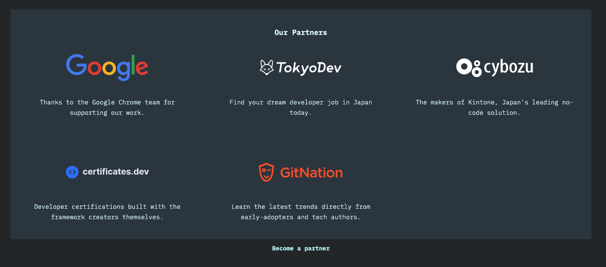

こんにちは！ サイボウズ株式会社 プロダクトエンジニアの [くらっち (@kuracchi04)](https://x.com/kuracchi04) です。

## はじめに

サイボウズは 2025 年 4 月より、W3C のメンバーに加入しました。

https://blog.cybozu.io/entry/joining-w3c

標準化プロセスに関わることができるようになるための最初の一歩として、フロントエンドエンジニアの一部のメンバーは積極的に Web 標準のキャッチアップを行っています。

そこで、毎月メンバーが興味を持った Web 標準に関する話題や、実際に標準化プロセスに関わることができた場合にはその報告などを 1 つの記事としてまとめ、紹介していきます。
また、ここでは W3C に限らず、TC39 や WHATWG などの標準化団体のトピックについても扱います。

:::message
今月の執筆者は以下の 5 名です。

- [nus3](https://x.com/nus3_)
  - State of系サーベイへのスポンサーのお知らせを執筆
- [Saji](https://x.com/sajikix)
  - ECMA402 (Intl) 周りのトピックを執筆
- [mehm8128](https://x.com/mehm8128)
  - 主にアクセシビリティに関連するトピックを執筆
- [くらっち](https://x.com/kuracchi04)
  - ECMA262 周りのトピックを執筆
:::


## State of系サーベイへのスポンサー
State of JS などを運営されている Sacha Greif さんのスポンサーを、弊社でさせていただくことになりました！


https://devographics.com/

State of 系のサーベイでは、開発者が実際にどの機能やライブラリを利用していて、それらをどう感じているのかを知ることができます。サイボウズでも、プロダクト開発の際に参考にさせてもらっています。

State of 系のサイトにメールアドレスを登録しておくと、サーベイの開始時期をメールで知らせてくれます。結果を見るだけでなく、普段プロダクト開発をしている方はぜひサーベイに参加してみてください。

回答していく中で、この 1 年で追加された機能を振り返ることができたり、知らなかった機能に出会えたりするのでおすすめです。

## HTML

### Updated Candidate Recommendation: Scalable Vector Graphics (SVG) 2
https://www.w3.org/news/2026/updated-candidate-recommendation-scalable-vector-graphics-svg-2/

SVG2 の Candidate Recommendation Snapshot が更新されました。
2026/12/1 までコメントを募集しているとのことです。

### Blink: Intent to Prototype: The focusreset event
https://groups.google.com/a/chromium.org/g/blink-dev/c/TknnNmZAI_k/m/8we5pYbKAwAJ

要素が消えてキーボードフォーカスがリセットされたときに発火する、`focusreset` イベントの Intent to Prototype が出ました。

Chromium では要素が削除されたときに `blur` イベントが発火しますが、Gecko と WebKit では発火しないため、新たにイベントを用意し、Chromium でも要素が削除されたときにはこちらのイベントを発火するようになる予定とのことです。

これは、UI ライブラリで hacky な方法を使ってフォーカス制御している utils などを置き換えるのに役に立ちます。

### Blink: Intent to Prototype: document.advanceFocus() and beforefocus
https://groups.google.com/a/chromium.org/g/blink-dev/c/AfSWXY8enI8/m/KjEIra48AgAJ

`element.focus()` はキーボードフォーカスの移動先が分かっている場合に移動先要素のメソッドを利用して発火します。しかし、Tab キーを押したときのように、ブラウザが次の移動先を選択してキーボードフォーカスを移動させたいときのメソッドがありませんでした。
そこで現在 Open UI で議論中である `document.advanceFocus()` や `beforefocus` を用いて、移動先要素の計算をブラウザに委ねて「次のフォーカス可能要素にキーボードフォーカスを進める」ということを命令するメソッドが開発されるようです。
`focusgroup` 属性よりも低レベルで命令的なメソッドになっています。

併せて、要素がフォーカス可能かどうかを紹介する API の案も出されています。
[Proposal: Expose sequential focus navigation primitives · Issue #13051 · whatwg/html](https://github.com/whatwg/html/issues/13051)

### Gecko: Intent to prototype: Retain focus when elements become disabled
https://groups.google.com/a/mozilla.org/g/dev-platform/c/POZHELB9Qr4/m/IndtiiBOAQAJ

`button` などの要素にキーボードフォーカスしている最中にその要素が `disabled` になったとき、キーボードフォーカスを失わないようにする変更のプロトタイプが作成されています。
今まではキーボードフォーカスを失っていたため、`disabled` 属性の代わりに `aria-disabled` などを用いて無効化状態を実装する hack が用いられることがありましたが、そのような対応が不要になります。
なお、一度フォーカスを外して再度戻ったときには、今まで通りフォーカスが当たらないようです。
[Should focused elements which become disabled lose focus? · Issue #13159 · whatwg/html](https://github.com/whatwg/html/issues/13159)

## ARIA・WCAG

### feat: add listview role to ARIA
https://github.com/w3c/aria/pull/2951

TPAC にて、List View というインタラクティブなリスト構造のセマンティクスを定義する議論がありました。

`listbox` とは違ってフォーム要素ではなく、`grid` とは違って 1 次元であるような UI で、チャットのメッセージ一覧、最近開いたファイル一覧、ページネーション、カルーセルなどが例として挙げられています。

List View 内では Tab キーの代わりに矢印キーで操作できるようにすることで、ページを読み進めるのに Tab キーを押す手間を省くことができるというメリットが提示されています。

これに対して、新しく `listview` のような親 role と、それに対応する子 role を追加することが決定しました。そして、`ul`, `ol` 要素に `listview` role がつけられると、その子の `li` 要素には自動で子 role がつくようにするとのことです。

なお、role 名は未確定のようです。

参考
- [Interactive lists | Sarah Higley](https://sarahmhigley.com/writing/interactive-lists/)
- [A proposal for a listview role to discuss during TPAC 2026](https://gist.github.com/smhigley/7aeea63030c6b05ca98427c4f90efc1a)

### Filtering a listbox with a text field (filterable select)
https://github.com/w3c/aria/issues/2841

現在 Open UI で検討されている Filterable Select という UI のアクセシビリティマッピングについて、TPAC で議論がありました。

テキスト入力欄に隣接してリストボックスが存在している、GitHub のラベルフィルター UI のようなものが想定されています。

一見 `combobox` role が適切なように思えますが、今回のパターンは開閉状態を持たない、入力したテキストとは別で選択肢の値が送信値になる、入力しなくても直接選択肢を選択できるといった違いから、適さないという結論になりました。

また、`aria-activedescendant` を誤った使い方をしてアクセシビリティ上の問題が発生するケースも取り上げられ、`aria-activedescendant` の仕様が改善されることになりました。

### [accname PR 235] feat: update step 2F to exclude nodes referenced by aria-actions
https://github.com/w3c/aria/pull/2208

accessible name に使われる text alternative の計算ステップにおいて、`aria-actions` で参照されているノードが除外されるようになるようです。

### Simplify allowances for explicit declaration of implicit role on elements
https://github.com/w3c/html-aria/issues/612

`button` 要素の `button is also allowed, but NOT RECOMMENDED.` や `del` 要素の `Any role, though deletion is NOT RECOMMENDED.` など、要素が持つ暗黙の role を指定するのを非推奨であると記載するのをやめるという issue です。

暗黙の role を指定するのは多くの場合不要ですが、指定することでアクセシビリティを損なうこともありません。よって、基本的にはこのような記述を削除し、暗黙の role を指定することでアクセシビリティ上の問題が発生する場合のみ明記する方針になるとのことです。

### browser accessibility heuristics wiki
https://github.com/w3c/aria/pull/2931

以前紹介した browser accessibility heuristics wiki のページに、WebKit で `ul` / `ol` に対して `list-style-type` を `none` に指定すると、`list` role がつかなくなるというヒューリスティックが記載されるようです。これは不具合ではなく意図的な動作です。

参考
- https://x.com/cookiecrook/status/1337226933822603270
- [170179 – VoiceOver does not announce a list for groups of links when list-style: none;](https://bugs.webkit.org/show_bug.cgi?id=170179)

### ACD - Accessibility Compat Data
https://acd.lolaslab.co/

ACD Project の Web サイトが公開されました。

ACD の概要や貢献方法、その他記事が公開されています。

## JavaScript

### ECMA402
https://github.com/tc39/ecma402/blob/main/meetings/notes-2026-10-08.md

今月公開された、10 月 8 日の TG2 meeting notes の内容です。

#### How should JS handle un-deprecation of EST5EDT, CST6CDT, MST7MDT, PST8PDT in TZDB 2026d?
https://github.com/tc39/ecma402/issues/1103

`EST5EDT` などのタイムゾーン ID は IANA の TZDB で一度非推奨になりましたが、互換性への苦情を受けて TZDB 2026d で非推奨が取り消され、再び独立したゾーン（primary zone）の扱いになりました。このままだと `Intl.supportedValuesOf("timeZone")` の列挙結果に含まれ、タイムゾーン選択 UI にも表示されます。これらのゾーンは過去や将来の日付で都市ベースのゾーンと結果が一致しない場合があり、米国やカナダで夏時間の廃止が進むとその差はさらに広がるため、ユーザーが誤って選んでしまうことが懸念されています。

現状のブラウザの挙動は、Firefox と Chrome が都市ベースの ID（`America/New_York` など）の alias として扱い、Safari は ID そのものを受け付けない、と 2 通りに分かれています。TZDB と CLDR が変更を元に戻す見込みは低いため、ECMAScript 側で対応することになりました。

- これらの ID を canonical な ID としては認めないと仕様に明記する
- alias として受け付けるかどうかは実装に任せる（Firefox / Chrome / Safari の現状の挙動はどれも仕様に沿ったままになる）

という方針で、JGT が PR を書き、TG1 に諮る予定です。

#### add String.toTitleCase, String.toLocaleTitleCase
https://github.com/tc39/ecma402/issues/294

文字列をタイトルケース（単語の先頭を大文字にする）に変換するメソッドの提案です。CSS には `text-transform: capitalize` がありますが、JavaScript には同等の機能がありません。CSSWG と次の進め方を相談するため、SFC が TPAC のブレイクアウトセッションを申し込むことになりました。CLDR と ICU がアイルランド語の大文字小文字変換に対応していない点も、議題に含めるよう求められています。

#### Duration / time units in Amount
https://github.com/tc39/proposal-amount/issues/139

Intl Sequence Units（`foot-and-inch` のような複数単位の組み合わせを扱う提案）は時間の単位をサポートしないため、Amount で `minute-and-second` のような時間の単位を持つ値をどうフォーマットするかが議論になりました。EAO と RGN は `Intl.DurationFormat` を使ってフォーマットすべきという立場で、その場合 `toLocaleString()` の options が NumberFormat 用と DurationFormat 用の 2 通りの形を取ることになります。SFC は options の形が分かれることに反対し、時間の単位ではエラーを投げてもよいという立場でした。結論は出ず、Amount から `Temporal.Duration` へ変換する手段（`Amount.prototype.toDuration` や、`Temporal.Duration.from` が Amount を受け取るなど）について SFC が Issue を立てることになりました。

#### Exact input handling for sequence unit values: Iterable vs. Array-like vs. IsArray
https://github.com/tc39/proposal-intl-sequence-units/issues/19

Intl Sequence Units に渡す値の受け取り方（Iterable / Array-like / 配列のみ）に関する Issue です。EAO がこの Issue は TC39 の AI ポリシーに違反しているとして議論をスキップすることを求め、議論は延期になりました。

#### Should we coerce the value field?
https://github.com/tc39/proposal-intl-unit-protocol/issues/6

Intl Unit Protocol は、`value` と `unit` のフィールドを持つオブジェクトを `Intl.NumberFormat.prototype.format()` に渡して、数値と単位をまとめてフォーマットできるようにする Stage 2 の提案です。この Issue では、`value` フィールドに対して既存の `format()` と同じ型変換（`Symbol.toPrimitive` を実装した独自の数値型も受け付ける）を行うかが議論されました。NumberFormat が長年独自の数値型を受け付けてきたことを前例として、現状の仕様（型変換を行う）のままにする方向です。

#### Should we check for the protocol even if the formatter is not a unit/currency formatter?
https://github.com/tc39/proposal-intl-unit-protocol/issues/7

現状の仕様では、`format()` は常に引数から Intl Unit Protocol のフィールドを読み取ります。これを `style` が `"unit"` か `"currency"` のときだけ読み取るように変更することで合意しました。提案の normative な変更になるため、SFC が次の TG1 に諮ります。

#### Input unit type checking
https://github.com/tc39/proposal-intl-unit-protocol/issues/8

不正な単位に対する例外を、フィールドの読み取りなど外から観測できる処理のどの時点で投げるかが論点として残っています。この点は Stage 2.7 のレビューで取り上げることになりました。

#### Cyclic year doesn't show up in resolvedOptions
https://github.com/tc39/ecma402/issues/816

中国暦などの干支で年を表すカレンダーで、`Intl.DateTimeFormat.prototype.resolvedOptions()` の結果に `year` が含まれない問題です。仕様では、フォーマットのパターンに `relatedYear` が含まれていれば `year` も含まれることになっており、仕様は正しく実装側が準拠していない、という確認になりました。この挙動を検証する test262 のテストを追加することになりました。

#### Normative: Define %TypedArray%.prototype.toLocaleString
https://github.com/tc39/ecma402/pull/1095

TG2 の議題ではありませんが、今月マージされた normative な PR です。ECMA-262 は、ECMA-402 を実装する処理系では `%TypedArray%.prototype.toLocaleString` を `Array.prototype.toLocaleString` と同じように置き換えるよう求めていますが、ECMA-402 側にその定義がありませんでした。この PR で ECMA-402 に定義が追加され、各要素の `toLocaleString` に `locales` と `options` が渡されることが明記されました。

### ECMA262

#### Deferred re-exports advanced to stage 2.7
https://github.com/tc39/proposal-deferred-reexports

再エクスポートに `defer` を付けることで、使われていないモジュールの読み込みと実行をスキップできるようにする提案です。
TC39 第 116 回の MTG で Stage 2 から Stage 2.7 へ昇格しました。
ただし、エディタ（ECMA262の仕様書の編集を行うグループ）のレビューが未完了のため、エディタ承認を条件とした昇格です。
ライブラリのエントリポイントがすべての公開 API を再エクスポートする「バレルモジュール」パターンでは、使わない機能まで含めてモジュールグラフ全体が読み込まれます。
バンドラの `tree-shaking` は副作用の扱いがツールごとに異なり、ブラウザで ESM を直接実行する場合は使えません。
この提案は、「使われなければ無視して良い」再エクスポートを表現できるようにするものです。

```js
// math.js
export defer { add } from "./math/add.js";
export defer { sub } from "./math/sub.js";
export { mul } from "./math/mul.js";

// main.js
import { add, mul } as math from "./math.js";
import("./math.js", { exports: ["add", "mul"] }); // 動的 import 版
```

#### Composites advanced to Stage 2
https://github.com/tc39/proposal-composites

`Map` や `Set` のキーとして使える、値ベースの等価性を持つ `Composite` を導入する提案です。
TC39 第 116 回の MTG で Stage 1 から Stage 2 へ昇格しました。
現在の Map / Set は要素の同一性判定に `SameValueZero` を使うため、オブジェクトは「自分自身とだけ等しい」扱いになります。
構造化された値をキーにしたくても、中身が同じ 2 つのオブジェクトは別物と判定されてしまい、この挙動を変える手段はありません。
回避策として `JSON.stringify` で文字列化してキーにする方法がありますが、キーの列挙順で結果が変わる、循環参照で例外になるなど、正しく使うのが難しいものでした。
`Composite` は「中身で等価判定したい場合に明示的に選べる別の手段」で、これを使うと同じ中身なら同じ参照になるオブジェクトを作れるようになります。

```js
const pos1 = Composite({ x: 1, y: 4 });
const pos2 = Composite({ x: 1, y: 4 });
pos1 === pos2; // true（同じ値の組からは同じオブジェクトが返る）

// 既存の Map / Set でそのままキーとして機能する
const itemAtPosition = new Map();
itemAtPosition.set(pos1, "book");
itemAtPosition.get(Composite({ x: 1, y: 4 })); // "book"

// キーはソートされ正規形を持つため、記述順は等価性に影響しない
Composite({ b: 2, a: 1 }) === Composite({ a: 1, b: 2 }); // true
```

#### Bigint from exponential advanced to stage 2
https://github.com/tc39/proposal-bigint-from-exponential

`1e6n` のような指数表記で BigInt を書けるようにし、`BigInt("1e6")` のような文字列からの変換も受け付けるようにする提案です。
TC39 第 116 回の MTG で Stage 1 から Stage 2 へ昇格しました。

```js
// これまで: 桁を手で書く
const scale = 1_000_000_000_000_000_000n;
BigInt(1e21); // Number を経由するので精度が保証されない

// この提案: 指数表記で書ける
const scale2 = 1e21n;
BigInt("1e21");      // 1000000000000000000000n
BigInt("86.4e12");   // 86400000000000n（整数になる小数部は許容）
```

## Baseline

### 📃 October 2026 release notes
https://web-platform-dx.github.io/web-features-explorer/release-notes/october-2026/

## Misc

### THIS IS FOR EVERYONE の日本語訳が発売
https://amzn.asia/d/03y67iYR

ティム・バーナーズ＝リー氏の THIS IS FOR EVERYONE の日本語訳本が、10/17 に発売開始されました。

### Web Sustainability | Our mission | W3C
https://www.w3.org/mission/sustainability/

W3C のミッションの 1 つとして、サステナビリティのページが追加されました。

W3C のサステナビリティへの取り組みの概要や、Sustainable Web Interest Group で作業中の Web Sustainability Guidelines の紹介があります。

Web Sustainability Guidelines については、以下の記事で紹介されています。
[Web Sustainability Guidelinesとは](https://zenn.dev/wsgj/articles/1f79582f108e02)